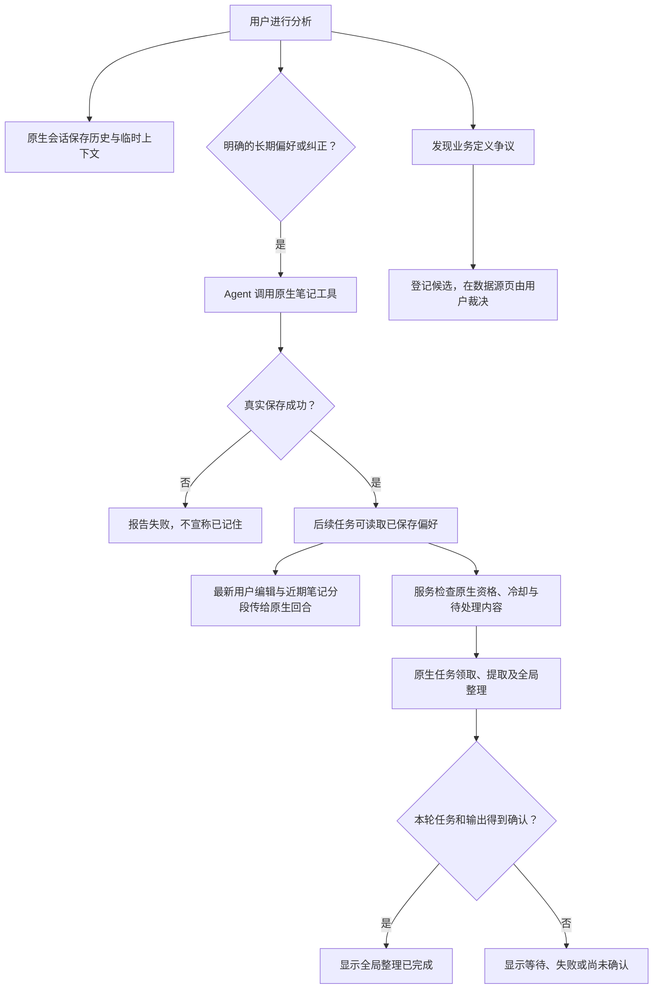
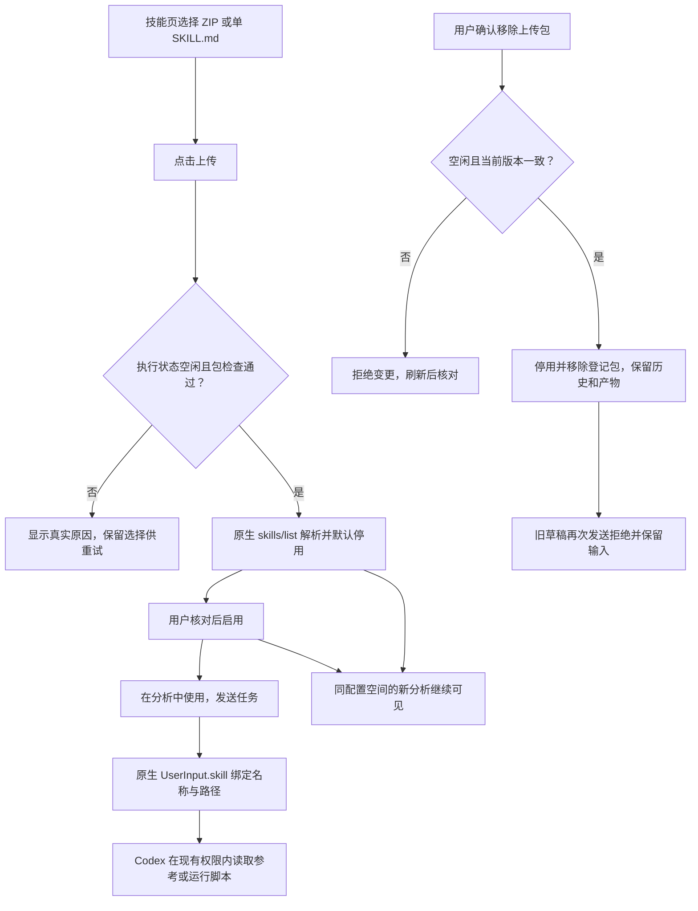
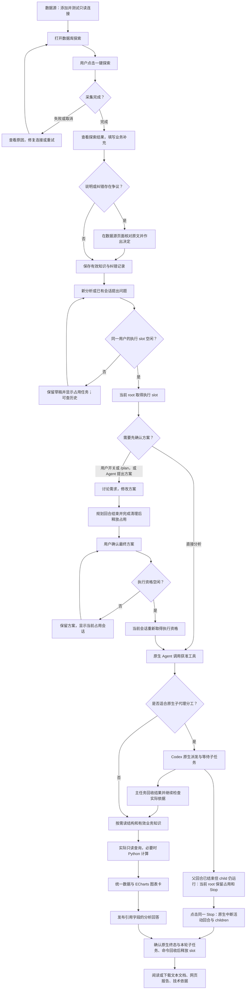
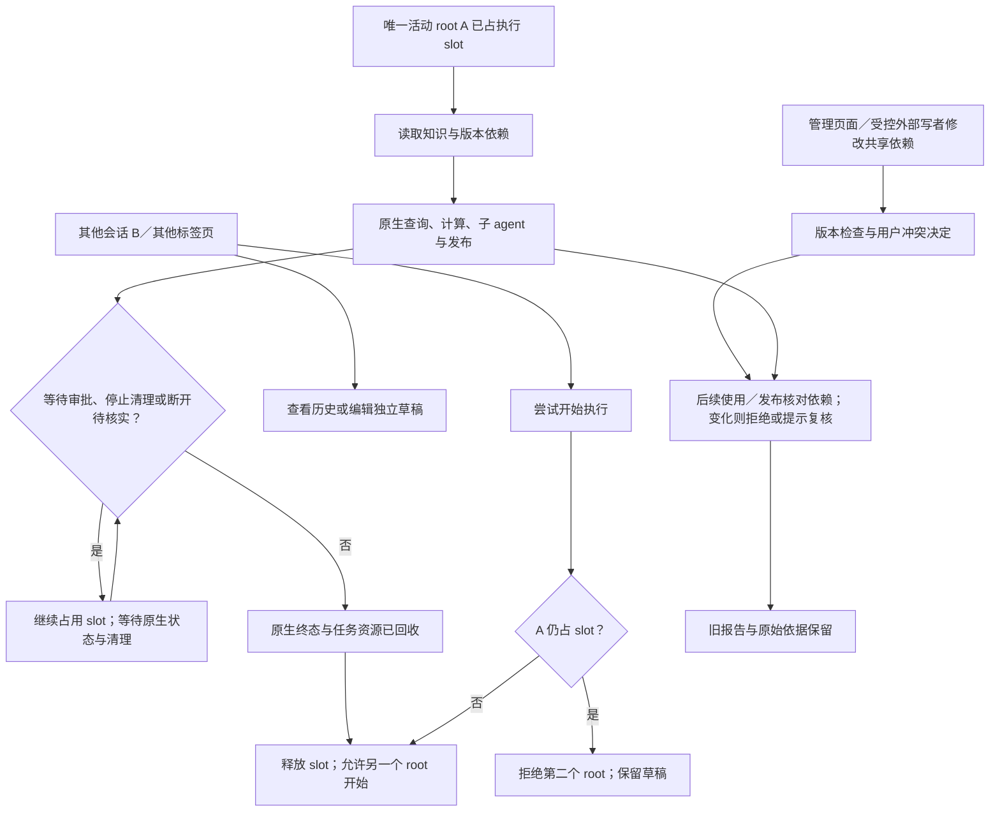

# Codex 数据分析工作台：功能与使用流程

## 当前增量：会话与记忆管理（2026-10-30）

两条策略继续生效：普通分析的临时条件、假设和结果留在原会话；经用户确认的业务背景、字段含义和指标口径在数据源知识页管理。明确长期偏好由 Agent 调用原生笔记工具保存，成功后可供新会话读取；模型口头承诺不表示保存成功。

1. 打开“设置 → 查看与编辑记忆”，分别查看“已保存的偏好”和“全局摘要整理”。保存编辑后，后续任务和新会话可读取当前内容；全局摘要另由原生异步整理，不随保存同步改写。
2. 窗口可见时每五秒只读更新状态，关闭后不再读取，后台原生整理不由此停止。编辑中的草稿不会被状态刷新覆盖；另一页面已经保存时，旧版本保存会报冲突并保留草稿。先复制需要保留的草稿，再点击“载入已保存偏好”，确认放弃当前草稿后核对最新内容并修改保存。
3. 从“后台维护记录”查看真实维护状态和清理结果。内部记录按精确登记 ID 从普通分析列表中分离，旧维护链接也会转到记忆管理；同名正常会话不会被隐藏。原生写锁不能通过关闭网页或强删锁解除。
4. 归档用于收起历史并保留恢复能力。永久删除按原生规则执行，成功后清理对应会话摘要，全局摘要异步更新；独立保存的偏好和确认业务知识保留。删除框提供长期记忆和数据源管理入口，失败保留原生原因。
5. “历史任务摘要（原生提取记录）”只展示已有原生记录及来源时间、当前来源状态。普通新分析不因闲置而产生该面板记录；恢复原分析仍使用原生历史和上下文。生成摘要不会自动填入个人偏好编辑器。

当前偏好和近期笔记通过独立原生不受信任上下文完整传递，应用规则另行分段，避免单项原生预算截掉中间纠正。新回合和原生执行中补充消息使用最新保存内容；已经读入进行中模型请求的旧内容不能追溯撤回。旧报告保留原文，业务依赖变化仍走已有复核机制。

本轮真实 Flash 已完成保存偏好、新分析读取、管理页纠正后新分析读取，以及删除原聊天后继续读取独立偏好；实际两页冲突／关闭停止刷新、同名用户记录保留、维护直链与空态也有收据。真实后台维护完成及清理已确认，但浏览器关闭与原生任务完成同秒，本轮只证明清理晚于关闭。16:40 的既有自然冷却全局记忆检查另有[独立完成证据](test-results/memory-management-2026-10-30/scheduled/)。实际验收见[TEST_REPORT.md](TEST_REPORT.md)；下方旧文案与本节不一致时，以本节为准。

## 当前增量：本地上传 Skill（2026-10-30）

本节是用户最新确认的安装范围，优先于下方保留的“仅四个内置技能”和在线下载历史记录。产品支持用户在技能管理页上传本地技能，不提供公开 GitHub 在线安装入口；既有下载超时不再是待办或验收阻塞。这是产品安装路径的限制，不是对 Agent 所有网络访问设置出口防火墙。聊天附件仍仅支持图片。

### 本地技能的使用流程

1. 侧栏打开“技能”，选择本地 ZIP 或单 `SKILL.md`，点击“上传技能”。ZIP 可以带参考、脚本和资源；最大 8 MiB，服务器同时限制解包体积、文件数和路径。这里是技能管理入口，聊天框仍仅接收图片。
2. 上传本身不会执行脚本或安装依赖。成功表示文件已经检查、原生 Codex 解析成功并确认停用；先核对内容，再启用。若需要运行时或第三方服务，由包本身和现有配置满足，不假装依赖已就绪。
3. 点击“在分析中使用”将原生技能选择写入当前草稿；发送后才由 Codex 在现有权限和审批机制内使用。新建会话继续共享已登记技能与启停状态，临时消息仍按会话隔离。含空格的名称可正常选用。
4. 不原位改写上传包：文件清单和哈希是登记依据。损坏或改变后单独显示不可用原因并停止新使用，不影响其他包；需要修改时移除后重新上传。内置四技能没有独立卸载按钮。
5. 移除上传包须确认当前版本；版本冲突要求刷新核对。分析运行、等待审批、清理或回执未知时暂不能安装、启停或移除。移除保留历史、任务产物及草稿，旧草稿引用再发送会拒绝并保留文本；不会悄悄当成普通文字发送。
6. 内置“安装技能”卡片的“上传本地技能”只打开文件选择器；不会启动模型或下载 GitHub 内容。其他三个内置技能照常通过“在分析中使用”选择。

真实 ZIP／单文档、原生默认停用、Flash 双技能调用／脚本产物、忙碌拒绝、坏包清理、刷新／跨新分析以及移除后旧草稿拒绝均有独立收据，见 [验收报告](TEST_REPORT.md)和[本批归档](test-results/uploaded-skills-2026-10-30/)。同一配置空间共享功能尚非多租户隔离；已注入模型上下文的内容不能因移除而追溯撤回。

> **当前测试范围调整（用户确认，2026-10-30）：** 官方 Skill 在线下载不再追加测试，既有超时仅保留为历史记录，不再列作待修复或验收阻塞。查询期间人为 SIGKILL 数据库查询 MCP 移出当前必测项，其已执行的故障注入结果保留；不要求本轮补做“强杀后数据库立即取消”。正常用户点击“停止当前分析任务”的原生中断／取消、审批拒绝，以及 MCP 安装、配置、启停和实际使用仍保留验收。既有下载探针访问公开 GitHub，超时原因未确认，不能归因于未登录 ChatGPT。

适用于当前 Web 页面、deepseek-flash 和已配置的只读数据源。首要实现原则：固定 Codex 版本已有可用原生能力就使用原生能力；页面不替代原生执行与委派。新建会话为另一项分析保留独立上下文，不会自动开始执行；同一服务配置空间的数据源、已采用知识、Skills、MCP、指标和记忆设置继续共享。本文描述入口、最终规则和验收要求，不保证模型对所有问题的理解或所有自由文案正确。当前实际补测与问题修复以 [2026-10-30 验收](AUDIT_2026-10-30.md)为准；下方保留的10月29日验证时间表是阶段记录，不以旧双 root 通过结论代替当前资源准入验证。

## 当前增量：数据分析能力生命周期与协作核验（2026-10-30）

本轮真实结果见 [能力协作审计](AUDIT_2026-10-30.md)，交付归档路径为 [capability-lifecycle-2026-10-30](test-results/capability-lifecycle-2026-10-30/)。一个执行 root、原生线程／委派和仅图片上传规则不变。以下步骤说明真实使用入口，不把测试脚本作为产品操作要求。

- **Skills**：在技能页查看已部署的四个保留原生技能；选择“在分析中使用”后，结构化技能意图与草稿一同保留。若随后停用该技能，发送应明确拒绝并保留草稿；重新启用后再发送。原生 bundled 技能随运行时部署，没有单独卸载操作。本批实际 Flash 验证 openai-docs 结构化输入；官方原生安装器在线下载另受120秒超时阻塞，不能把部署／使用通过说成任意在线安装通过。
- **MCP**：在 MCP 页添加本地启动命令或配置可用的远端地址，保存后由原生重载并发现工具。编辑只改变所提交字段，陈旧版本保存拒绝且留稿；相同配置显示“配置未变更”。启停、移除后按真实目录和状态确认，不把保存配置视为服务或所有工具已经可用。本批实际本地工具和一个国内远端只读工具已调用；一次真实SQL运行中的MCP强退已验证明确失败、不自动重查或假发布，原生重载后用户显式重试成功；数据库查询不会因MCP强退而保证立即取消。
- **执行中补充**：当前任务还在运行时，可在输入框输入补充要求并按 Enter，实际走原生 turn/steer；不是另起一个用户 root。停止按钮仍负责中断。补充不自动改动已经确认的共享知识或指标口径。
- **指标派生与变更**：Agent 按当前已确认规则执行后，可继续用 SQL／Python 整理并绘图。系统继承规则当前性依赖，但不会把任意新公式认证为原口径。用户在管理页修改或停用原规则后，旧派生结果不能继续读取给Agent、计算、绘图或发布；历史页面和下载保留，报告提示需要复核。重新执行须先使用当前有效且已确认的规则。
- **上下文压缩**：由原生配置自动触发，无需新增压缩按钮。压缩不生成新的数据库读取时间，也不撤销依赖检查；后续使用仍核对原结果。独立阈值测试已验证自动压缩后可以读取和发布原派生结果、无需重查，不承诺保留每一条自然语言细节。

普通文档／Skill reference 的原生文件编辑仍不具有通用全文件CAS或自动恢复。没有新增完整Git界面；分析输入只对已登记的文件指纹执行稳定读取和最终复核。C05 已实际确认隔离 Python 执行期间改自有CSV后拒绝；旧文档引用拒绝和新导入恢复也已完成。MCP执行中强退与用户显式恢复也已实测，数据库残余直至自然结束的边界保留。真实child已完成查询／Decimal派生，父任务复用同resultId绘图发布而不重查，卡片展开与刷新过程已实际操作；导航修复后审批刷新也已实际收到原生重送requestId=0并拒绝，原受控写入未执行、任务未重发；刷新不是批准或旧响应重放，不能因流程图画出路径就称该组合已通过。

本批空闲后完整后端442项（438通过、4条件跳过，四项另原生启用通过）、JS341项、语法及原生完整性均有独立收据；工程检查不认证任意业务解释或生产容量。本轮独立服务与MySQL已停止，历史和配置保留。日常8765在空闲后保持原参数／目录／环境原位重启621324→706812，实际浏览器确认native707015、新代码、Flash／DeepSeek、原生MCP重载及43条历史列表，未提交模型任务。16:40北京时间的未来全局记忆检查及42399继续保留，结果尚不存在，仍未验证完成。归档入口为capability-lifecycle-2026-10-30/cases.json与manifest.json；大JSON为.json.gz，原始失败保留、凭据和配置空间排除。

## 执行与共享边界（最终用户规则）

- 同一用户一次最多 **1 个 root 会话执行任务**；历史会话、已加载闲置会话和草稿数量不限。新建或查看历史不等于启动执行，也不按“3 个会话总量”限流。
- 等待审批或用户输入、停止清理中、浏览器断开后尚未核实原生任务结束时，原 root 仍占执行 slot。点击停止、超时、关闭页面或 WebSocket 断开本身都不能释放 slot。只有原生终态与该任务命令／子任务清理已确认后，其他 root 才可开始；状态不明时应提示核对而非启动第二个任务。
- “等待审批／输入”指原生回合尚未结束的真实等待。已完成的计划草稿等待用户点击确认，不是正在执行的任务；此时可以在其他会话执行。确认方案时重新检查执行资格，不预留无限期锁。
- 原生子 agent 仍可由当前 root 派发，归属于该 root；它们不是第二个用户 root。Web 负责单 root 准入、归属与呈现，不代替原生规划、审批、委派、等待或中断。
- 临时上下文按原生 thread 隔离：草稿、消息、当轮假设、进度、工具输出、审批和停止操作不能串到其他 thread。共享的是已显式保存的长期偏好、已确认且当前有效的业务知识，以及同配置空间的数据源、Skills、MCP、指标与时效设置。未确认推断或普通聊天内容不会因切换会话自动变成共享事实。

Web 服务持有原生 app-server，通过本地 Unix WebSocket 接入；后台观察连接独立于网页，每个网页也有各自的原生连接。刷新、关闭网页或退出浏览器不会终止服务持有的原生进程。服务停止、原生错误和用户停止仍可能结束任务，最终状态以原生事件及命令／子任务清理证据为准。

Linux 的 Web 宿主异常退出会触发启动边界的进程死亡绑定，避免本服务创建的原生进程遗留；不是浏览器连接的生命周期。运行时错误／回执未知仍须核对，显式恢复不重发任务，不承诺跨平台或任意脱离原生管理的进程已回收。

原生 `thread/start`／`thread/resume` 建立各连接的线程订阅，`thread/read` 只读取快照。其他 root 占用时，查看历史只读快照和分页，不调用可能恢复目标／队列的 `thread/resume`；待获得执行资格后才真正恢复。审批仍由原生连接处理，不向所有页面广播审批请求；重新连接不等于审批已转交或获准，也不自动重发任务。

## 一、从探索到分析结果

探索是用户主动开启的前置准备，不必每次提问都重新执行。未准备时普通只读查询仍可使用指定表的结构读取；页面应明确说明准备状态。

## 二、主要功能怎样使用

| 功能 | 操作路径 | 应看到的反馈与边界 |
|---|---|---|
| 配置数据源 | 侧栏“数据源”→添加数据库→填写只读连接→保存并测试 | 显示真实连接结果；不能授予写数据库权限。支持 MySQL、PostgreSQL、ClickHouse、Elasticsearch，专用探索能力随引擎不同 |
| 一键探索 | 数据源卡片→数据库探索→一键探索 | 进度和错误可见；可以取消，关闭窗口后后台任务不因关窗重复提交。实际结构与推测解释分开 |
| 补充业务背景 | 探索窗口业务补充→保存并用于分析 | 用户明确采用后供后续分析读取，保留历史；不会更改物理表结构或自动确认指标公式 |
| 查阅结构和纠错 | 探索窗口→详细资料→实际结构／业务知识／待处理冲突；纠错与决定记录 | 可按对象查看、补充或纠正。Agent 的提议需要用户确认。裁决位于数据源页面，不在聊天中自动批准 |
| 原生子代理 | 对话中说明需要分工，或由 Codex 判断委派；对话内子代理任务面板 | 展示原生派发、子任务模型、最近状态和返回内容；可按需只读查看／刷新子任务过程。原生工具调用成功不等于子任务完成，主任务继续整合与依据检查 |
| 数据时效 | 数据源卡片→数据时效 | 留空不限制、0 表示仅当前任务、正整数为可复用分钟数。派生结果保留原始读取时间；不是业务日期筛选。并发修改需核对版本；冲突保留输入，可读取最新规则后决定是否保存 |
| 指标口径 | 数据源卡片→指标口径 | 手动填写定义并保存草稿，核对后单独确认。编辑、停用保留版本。没有确认规则不自动套用某行业口径 |
| 提出分析任务 | 新分析或已有会话→输入问题→发送 | 执行 slot 空闲时由当前 root 开始；其他 root 被拒绝且保留输入，可查看占用者与历史。不要求用户写 SQL 或 Python |
| 计划模式 | 输入框内“计划模式”开关或 `/plan` | 蓝色开、灰色关；裸 `/plan` 只切换模式，不会生成聊天回答。`/plan 具体问题` 进入后提出问题。切换要得到原生确认 |
| 修改和执行计划 | 方案卡→修改分析方案，或确认并执行分析→核对最终文本 | 最终确认的方案替换旧草案；退出计划模式不会自动执行已有方案。规划期间可能进行只读调查 |
| 执行进度 | 对话中的步骤进度及工具活动 | 来自原生步骤更新，不是按时间估算的百分比。模型没有发布步骤时工具活动仍可见 |
| 暂停和继续 | 父任务或 child 执行时点击输入框内同一 Stop→等待停止及清理确认→修改要求后发送 | 等待审批、停止清理或断开后待核实时仍占 slot。清理确认后才可让另一 root 执行；继续使用新的原生回合，不承诺恢复任意 Python 中间指令 |
| 数据和图表 | 同一结果卡切换数据／图表 | 数据分页、跳页、CSV；图表为 ECharts，可切换已有图、查看交互及下载 PNG，不额外展示重复表格 |
| 分析报告 | 完成回答下方“下载格式”→导出报告 | 文本文档为 Markdown；网页报告含静态图表且可打印；技术依据为 JSON。下载不改变聊天显示 |
| 字段依据 | 数据回答关联来源与执行记录 | 只检查列出的引用字段；文本、类别、日期与数字同样适用。不认证整篇解释、因果或源数据真实性。普通术语、用户参数、图片观察不因含数字而拦截 |
| Skills | 侧栏技能→本地上传、查看、启停、在分析中使用／确认移除上传包 | 四个保留内置及登记完整的上传包；上传默认停用、原生解析和调用；草稿刷新保留，停用／移除后拒绝留稿。installer 只打开本地选择器，不提供 GitHub 在线下载；新分析共享配置，不是租户隔离 |
| MCP | 侧栏 MCP 服务→添加本地启动命令或配置远端连接、编辑、启停及移除 | 由原生 Codex 保存和重载；高级字段保留、版本冲突留稿、同值不重复写入。核对真实连接／工具目录；已有回合工具集合和未结束调用依原生生命周期处理，不承诺即时撤回已交付工具或上下文 |
| 记忆 | 设置→查看与编辑记忆；对话中明确要求保留长期偏好 | 新分析 generate_memories=false；未暂停时启用原生 memories/use_memories/dedicated_tools。长期偏好通过原生 memories.add_ad_hoc_note 有收据地保存；临时条件和业务结果不自动进入共享笔记。既有摘要保留，记忆不能覆盖当前确认知识；已注入上下文不能撤回 |
| 历史与草稿 | 侧栏选择／新建会话；右键或更多操作 | 不限制会话总数；可在其他 root 占 slot 时只读历史和编辑草稿。真正恢复遵守执行准入及原生目标／队列恢复语义；归档保留内容，永久删除有确认且清理会话记录，不等于清理全部共享快照 |
| 图片 | 输入框加号→PNG、JPEG、GIF、WebP | 聊天附件仅图片，合计预算16MiB；图片观察不自动成为共享业务知识或已核验数据。技能包只从独立技能管理页上传 |

## 三、异常、纠错和跨会话

共享配置不共享临时任务上下文。不同会话的输入、消息、工具活动、步骤、审批和停止操作绑定各自 thread／turn；刷新或重连不能自动重发。浏览器断开不会杀死服务持有的原生进程，后台观察仍核对任务状态；原生任务失败或需要连接所属的审批时按实际原生协议处理。不能仅因网页断开释放 slot。原生请求回执未知或后台观察失败时阻止新提交，显示诊断信息；已知正在执行的原生回合仍可停止。其他标签页应看到已有占用并拒绝新 root；重连只能接回原任务或核实其终态，不创建重复执行。

业务管理决定可以在任务等待或执行期间发生，以验证依赖版本机制；它不会自动启动第二个分析 root。存在未决业务争议时，用户在数据源页面查看候选、原文、来源和版本后明确采用／拒绝，模型与测试根 Agent 不替用户裁定。已注入模型上下文无法撤回，但之后读取、计算与发布必须检查真实依赖。

单 root 准入消除了两个独立用户 root 同时执行并写同一文件的正常路径；它不使任意文件写入天然安全。当前 root 的原生 children、仍未结束的命令、管理编辑和外部 CLI 都可能碰到同一目标。分析输入继续使用既有稳定读取、hash／版本依赖检查；设置、知识、记忆编辑使用各自支持的 CAS／版本接口；成果采用不可变 resultId。需要 native children 写文件时由 root 明确分配独立输出路径和文件所有权，再汇总引用，避免共同覆盖 report.md 等通用名。原生 fs/writeFile 没有 expectedSHA256；apply_patch 的上下文匹配也不是整文件 CAS。不能声称任意 shell 会遵守 Web 文件锁，更不长时间锁整个工作区。

长期记忆按显式保存和原生维护区分：新分析会话的 memories.generate_memories=false，不把新临时分析自动提升为共享经验；未暂停时 features.memories、memories.use_memories 和 memories.dedicated_tools 启用，以读取既有记忆并调用原生 memories.add_ad_hoc_note 保存用户明确要求的长期偏好。显式 notes 在实际保存成功后可由原生工具读取，不必等待一小时；模型口头声称保存不等于真实保存收据。旧历史摘要不删除，具有资格的老历史仍按原生闲置、筛选条件进行逐会话提取；逐会话摘要与全局 consolidation 是两个阶段，全局合并另受原生冷却约束。临时上下文、临时假设和业务结果不进入共享笔记，确认业务知识保存在专用知识管理中。五分钟探索不保证任一后台整理阶段完成。

### 对话中发现已确认内容需要修改

可以在对话中说明问题并提出业务纠错候选，保留待修改原文、来源与建议理由；Agent 不能直接覆盖已确认的业务背景、字段解释或指标口径。用户到数据源／知识／指标管理页面核对当前版本，明确采用、拒绝或保存新版；确认后的有效版本供后续任务读取。若原任务正在查询或计算，依赖检查须发现版本变化并拒绝混用旧结果，必要时要求重新读取和执行；已完成报告保留原文与当时依据，显示需要复核，不静默改写历史。

当前任务的计划、条件和分析范围可以在对话中修改，仅作用于该任务；明确要求长期保存的个人偏好可由原生记忆工具留收据，并可在设置管理。它们均不代替业务知识管理页的确认，也不自动扩大为新的编辑功能。

## 四、如何报告使用问题

记录操作入口、会话、发生时间、输入、观察到的反馈、截图和能重现的步骤。区分“无法操作／状态不一致”“功能说明不清楚”“模型还在澄清需求”“系统机制发现数据或知识依赖失效”。无需自行判定哪份业务结论正确；真实争议按页面审批流程处理。

## 五、哪些由原生 Codex 执行

| 功能 | 当前分工 |
|---|---|
| 会话与执行准入 | 历史／草稿不限；Web 在同一用户范围只准入 1 个执行 root 并绑定所有权，等待／清理／断开待核实时不释放。原生 `thread/start`、`thread/resume`、`turn/start` 与事件仍管理实际任务；原生 child 归 root，不自建 Agent 循环 |
| 计划、步骤、澄清 | 原生 Plan 协作模式、用户输入请求及步骤更新；开关和方案确认是 Web 控件 |
| 子代理 | 原生 spawn／sendInput／wait／close；面板只读取和展示真实事件、`thread/read` |
| 审批、中断、文件与命令 | 原生审批、沙箱、工具与中断；停止后的终端回收仍通过原生接口 |
| 记忆读取、显式保存与整理 | 新分析禁用 generate_memories；未暂停时原生 dedicated tools 读取历史并以 add_ad_hoc_note 保存显式长期偏好。既有老历史和已保存 notes 仍由原生条件／维护合并处理，不生成替代摘要循环；用户编辑 CAS、暂停和查阅保留 |
| 数据源、业务知识、指标与时效 | 分析 MCP 补充原生没有提供的数据库业务管理、版本与执行依据；不替代原生规划和委派 |

当前接入规则优先使用固定版本的原生 `memories` 工具：新分析关闭自动生成资格，未暂停时保留读取和专用工具。显式保存需要实际 `memories.add_ad_hoc_note` 调用与返回；不能再以旧轮“专用工具未接入／前台只走 MCP 桥接”的限制描述当前目标。是否已按这些规则正确运行，仍需本轮真实串行 tester 验收，不沿用旧轮探针当作通过。

## 六、本轮如何验收

本次证据见[串行使用验收归档](test-results/single-execution-2026-10-29/)及[逐文件哈希清单](test-results/single-execution-2026-10-29/manifest.json)。下文收据中的原始临时目录是当时环境记录，不修改原始 JSON 来替换路径。

两位真实产品 tester subagent 使用同一隔离测试配置空间，先 A 完成定向脚本和最多 5 分钟自由探索，确认原生任务／命令回收后，再由根 Agent 明确发出 B 的开始信号。B 复用共享知识与显式偏好，但临时 thread 上下文独立。两人不同时操作或执行，也不比较谁的业务答案正确。完整顺序、可复制提示词、双标签页拒绝与证据模板见 MULTI_SESSION_AUDIT_2026-10-29.md。文档改动不等于这些测试已经执行。

A 已完成实际用户测试：定向操作 `12:09:26.604`～`12:49:13.137 UTC`，其中 `12:22:30.380`～`12:37:41.269` 暂停等待机制修复；自由探索 `12:49:13.159`～`12:50:56.086`，102.927 秒，最后新操作 `12:50:56.079`，早于 `12:54:13.159` 截止。`12:51:35.123` 完成最终核对并关闭浏览器，原生 execution 为 idle。证据见 `test-results/single-execution-2026-10-29/serial-a/summary.json`、`observations.md` 和 `A-final-cleanup-status.json`。

A 实际完成探索、Plan 澄清／修改／确认、两个原生 Flash 子任务、查询→Python→两张 ECharts→发布及 CSV／PNG／Markdown／HTML／JSON 下载；查询后修改知识导致旧派生被拒绝，再重读重查。全部页面关闭期间真实查询完成且未重发。首次 closed child 清理故障证据保留；修复后第二个真实 child 已产生 closedThreadHistory 证明并最终释放占用。旧记录 `closure.kind=closeAgent` 仅表示关闭尝试结束，安全确认依赖当前 notLoaded、完整已退出命令历史及版本核对，不能称为关闭 API 成功回执。

B 已在 A 结束后串行完成：定向 `13:09:47.603`～`13:39:50.482 UTC`，自由探索至 `13:43:47.543`，237.061 秒，最后新操作 `13:43:47.480`，早于 `13:44:50.482` 截止；`13:48:22.227` 核对 idle／无自有等待进程，`13:48:22.564` 关闭全部浏览器。原生 memories.search／read 实际取得共享偏好；B 未向模型提供 A 临时内容。测试控制器曾意外显示同用户历史预览，不能把本次测试称为完全盲测，也不能据此认定模型上下文串线。

B 真实验证了知识纠错在数据源页采信、旧稿版本冲突拒绝并留稿（本次实际 HTTP 400）、旧报告保留并提示复核、源时效过期拒绝／重查、受控服务目录 CSV 修改后旧依赖拒绝／重新导入计算成功；这不是恢复文档上传。真实审批 decline 后原候选写入未执行；未知 thread／错误 turn 的 Stop 未改变占用，清理期间第二 root 被服务端拒绝。刷新和全部关页后同一原生任务仍运行，重连未重发，随后实际停止并回收。CSV／PNG／Markdown／HTML／JSON 已实际下载。详见 `test-results/single-execution-2026-10-29/serial-b/summary.json`、`cases.json`。

原生 resume 和直连执行门禁修复已应用，B 的 process/spawn 原始请求被明确拒绝；历史 goal／queue 自动恢复竞争尚未单独真实触发，SQL 查询真正执行窗内的依赖修改仍未覆盖，全局记忆合并也未完成。工程验收分别记录为后端 418 项（414 通过、4 条件跳过）、19 文件 JS 308 项通过、语法 221 份通过。详见 MULTI_SESSION_AUDIT_2026-10-29.md 及 REPORT_MEMORY_LOOP.md 的 CW-097 起问题表和上方归档。

记忆另有独立阶段证据：旧 seed 历史自然闲置满一小时后，原生 stage1 已提取 1070 字逐会话摘要，见 `test-results/single-execution-2026-10-29/natural-memory-receipt.json`；该 seed 的全局 consolidation 仍受原生六小时冷却约束，未验证完成。它既不是新分析自动提取通过，也不能替代 A／B 的显式偏好共享验收。

后续一次全局记忆检查已实际安排在北京时间 `2026-10-30 03:45:11`，首检后最多只读观察一小时，无需浏览器在线；见[安装收据](test-results/single-execution-2026-10-29/scheduled/launch-receipt.json)。当前为 scheduled=true／notYetTested，不是合并通过；未来结果写入运行状态目录 `/root/Codex/.local-state/global-memory-2026-10-30/once/result.json`，不承诺自动通知或系统重启后恢复，历史／notes／结果全部保留。

日常 8765 服务已重启加载持久原生运行时；[1440 宽度只读检查](test-results/single-execution-2026-10-29/daily-readonly/receipt.json)确认 web-service／native-unix-websocket，零页面错误、零任务提交。这是生效与页面检查，不替代上述独立 Flash／MySQL 真实流程。

资源报告 `/tmp/codex-resource-20261029/report.md` 只包含无模型调用的已加载闲置线程／进程对照；3 线程场景不是产品并发目标。PSS 会随共享映射分摊变化，RSS 会重复计算共享页，均不能直接外推生产单 root 加 child／Python／查询的峰值。
